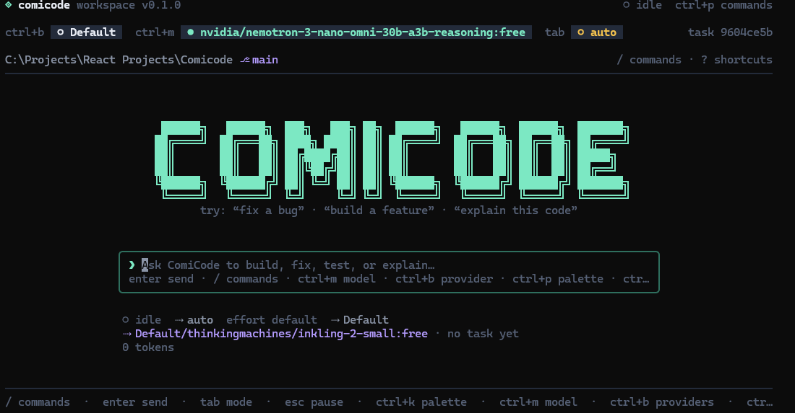
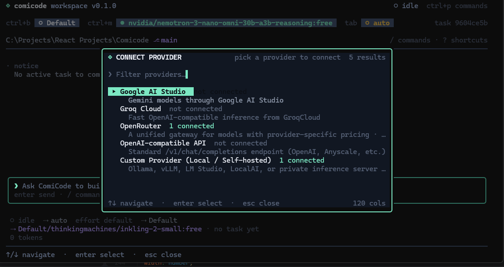
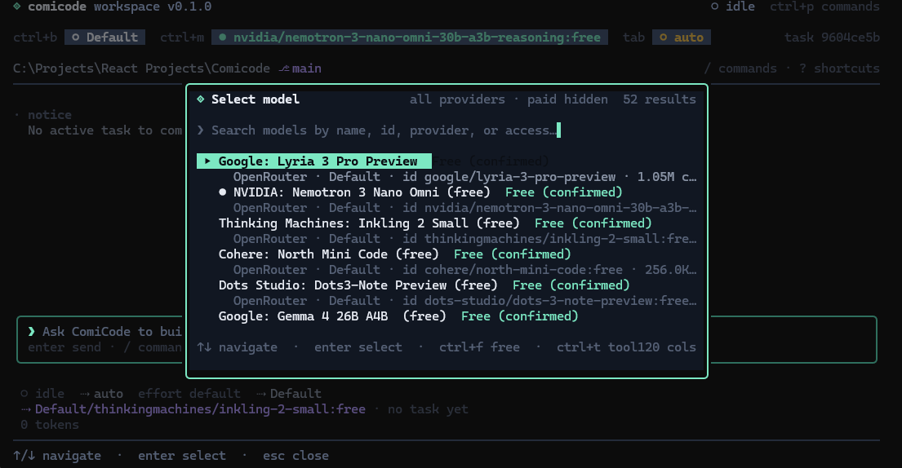

# ComiCode

ComiCode is an open-source, multi-provider AI coding agent for the terminal. It can inspect a project, write and patch files, run commands and tests, keep a persistent task history, and keep working across provider quotas by routing to the next eligible model.

It is not tied to a fixed list of AI vendors. Gemini, Groq, OpenRouter, and OpenAI are first-class providers, and **any OpenAI-compatible or Gemini-compatible endpoint can be added with its own base URL, auth header, model paths, and extra headers**. Local servers such as Ollama, LM Studio, vLLM, and LiteLLM work without an API key.

> **Repository:** https://github.com/ComibyteOrg/comicode

## Highlights

- **Real coding-agent loop** — inspect, search, read, create, edit, delete, apply unified patches, run commands, tests, lint, and builds, inspect diffs, and finish with a summary.
- **Quota-aware failover** — tries the selected model first, then other profiles of the same provider, then other providers, preferring free capacity. Pauses safely when nothing is eligible and resumes later.
- **Honest error handling** — distinguishes daily quota, rate limits, outages, network failures, auth problems, permission errors, missing models, context-length limits, billing restrictions, and unsupported tool calling. It honors `Retry-After` and provider reset headers and never invents reset times.
- **Persistent tasks** — SQLite-backed tasks, transcripts, attempt history, checkpoints, and project-state fingerprints. Resume after a quota pause, crash, or terminal close.
- **Bring any platform** — configurable base URL, API style, credential header/prefix, chat and model paths, max-token parameter, extra headers, no-auth local endpoints, and manual model IDs when discovery is unavailable.
- **Secure credentials** — OS credential storage where available (Windows DPAPI, macOS Keychain, Linux Secret Service) with an AES-256-GCM encrypted-file fallback. API keys are never stored in plaintext in SQLite or exported configuration.
- **Polished Ink terminal UI** — workspace, providers, models, history, usage, settings, command palette, confirmations, and live routing/usage feedback.
- **No telemetry** — ComiCode sends no analytics or usage data anywhere.

## Screenshots





## Requirements

- Node.js **22.13+** (Node 24 LTS recommended; ComiCode uses the built-in `node:sqlite` module, which requires the 22.13 floor to run without a flag).
- Windows, macOS, or Linux.
- At least one provider profile and API key, or a local no-auth endpoint.

## Install

Install ComiCode once as a global CLI. npm puts a small `comicode` launcher in
its global binary directory (usually already on `PATH`), so the command works
from any project folder and any new terminal.

The package is not published on npm yet. From GitHub:

```bash
npm install -g github:ComibyteOrg/comicode
comicode --version
```

`dist/` is gitignored, so npm builds it during installation with the package's
`prepare` script. Keep git's default branch installable and do not use
`--ignore-scripts`.

Share a build without repository access by installing the tarball:

```bash
npm pack                                    # run in the source checkout
npm install -g ./comicode-0.1.0.tgz         # run on the other machine
```

For a local development checkout:

```bash
git clone https://github.com/ComibyteOrg/comicode.git
cd comicode
npm install
npm install -g .    # builds and installs the global command
# or: npm link      # keeps the global command pointed at this checkout
comicode --version
```

If the command is not found, open a new terminal, run
`where comicode` (Windows) or `which comicode` (macOS/Linux), and compare it with
`npm config get prefix`. See [docs/install.md](docs/install.md) for PATH,
permission, version-manager, PowerShell, update, and uninstall guidance.

## Quick start

```bash
# 1. Connect a provider profile. The key is hidden and stored securely.
comicode providers add --provider gemini --name "Gemini personal" --api-key-env GEMINI_API_KEY
comicode providers add --provider groq --name "Groq free" --api-key-env GROQ_API_KEY

# 2. Discover models (or add one manually when /models is unavailable).
comicode models refresh
comicode models list --free

# 3. Start a task in the current project.
comicode run "Find the failing test, fix it, and run the suite"

# 4. If quotas run out, ComiCode pauses with diagnostics. Resume later.
comicode tasks list
comicode resume <task-id>
```

Run `comicode` with no arguments in an interactive terminal to open the TUI. In a non-interactive shell it prints help instead.

### Safe defaults

File edits, shell commands, dangerous commands, secret-file access, and paid fallbacks are gated. For non-interactive runs:

```bash
comicode run "update the changelog" --yes
comicode run "run the tests and fix failures" --yes --allow-commands
comicode run "use the paid model for this one run" --allow-paid
```

Dangerous shell commands additionally require `--allow-dangerous-commands`. Prefer interactive mode when you want to review diffs and commands before they run.

## Any AI platform

### OpenAI-compatible endpoint

```bash
comicode providers add \
  --provider custom \
  --name "My gateway" \
  --base-url https://gateway.example.com/v1 \
  --api-key-env MY_GATEWAY_KEY \
  --default-model my-coding-model \
  --api-style openai-compatible \
  --access unknown
```

### Custom auth header

```bash
comicode providers add \
  --provider custom \
  --name "Internal Azure-style gateway" \
  --base-url https://ai.example.com \
  --auth-header api-key \
  --auth-prefix "" \
  --chat-path /openai/deployments/my-model/chat/completions \
  --models-path /openai/models \
  --max-tokens-param max_completion_tokens \
  --extra-header "X-Organization: platform-team" \
  --api-key-env INTERNAL_AI_KEY \
  --default-model my-model
```

### Local server with no auth

```bash
comicode providers add \
  --provider custom \
  --name "Ollama local" \
  --base-url http://localhost:11434/v1 \
  --no-auth \
  --default-model qwen2.5-coder:14b \
  --access user-free \
  --refresh
```

### Gemini-compatible endpoint

```bash
comicode providers add \
  --provider custom \
  --name "Gemini-compatible proxy" \
  --base-url https://proxy.example.com/v1beta \
  --api-style gemini \
  --auth-header x-goog-api-key \
  --auth-prefix "" \
  --api-key-env PROXY_KEY \
  --default-model gemini-2.5-flash
```

Presets for DeepSeek, Mistral, xAI, Together, Fireworks, Cerebras, Ollama, LM Studio, vLLM, Azure, and LiteLLM are available with `comicode providers presets`. Presets are convenience defaults only — every endpoint uses the same configurable transports.

When model discovery is disabled or unavailable, add models by ID:

```bash
comicode models add "My gateway" my-coding-model --default
comicode models select my-coding-model
```

See [docs/provider-adapters.md](docs/provider-adapters.md) for every configuration field and transport detail.

## Routing and quotas

For each call ComiCode builds a capability-aware chain:

1. The explicitly selected model/profile (honored even when paid or unknown).
2. Other profiles of the same provider, including the current profile's other catalog models.
3. Other providers, with preferred providers and free classifications ranked first.
4. Capability filtering: tool calling is required for coding tasks; vision is required for vision tasks; policy context minimums apply.
5. Policy filters: paid models are blocked unless `routing.allowPaid` is enabled; unknown access is controlled by `routing.allowUnknownAccess`.

On failure:

- **Rate limit / outage / network** — retries with exponential backoff and jitter, honoring provider reset times up to `routing.retryMaxDelayMs`, then falls back.
- **Daily quota** — records a persistent limit for that profile/model and falls back immediately. A provider-supplied reset time is used; otherwise a short cooldown prevents an endless retry loop.
- **Auth, permission, billing** — quarantines the whole profile and falls back.
- **Model unavailable / unsupported tools** — blocks that model/profile for the task and falls back.
- **Context length** — retries once with a reduced context budget, then falls back.
- **Nothing eligible** — pauses the task, saves a checkpoint and diagnostics, prints the resume command, and never silently switches to a paid model.

`routing.allowPaid` is a persisted setting; `--allow-paid` and `/allow-paid on` in the TUI apply per run / interactively. Explicit user selections are always attempted first.

## Terminal UI

Launch with `comicode` on a TTY.

| Key                | Action                                                     |
| ------------------ | ---------------------------------------------------------- |
| `←` / `→` or `tab` | Cycle screens (workspace: only when the composer is empty) |
| `shift+tab`        | Previous screen                                            |
| `ctrl+k`           | Command palette                                            |
| `enter`            | Send a message / activate                                  |
| `esc`              | Pause a running agent, clear a filter, or go back          |
| `ctrl+c`           | Quit (ignored while a run is active; pause first)          |

Workspace commands: `/help`, `/workspace`, `/providers`, `/models`, `/history`, `/usage`, `/settings`, `/profile <name>`, `/model <name>`, `/resume`, `/allow-paid on|off`, `/new`, `/clear`, `/exit`.

Screens keep their state mounted, so switching tabs does not cancel a running task. File writes, deletes, commands, dangerous commands, and secret reads show an approval dialog with a diff when relevant.

## CLI reference

| Command                     | Purpose                                                                        |
| --------------------------- | ------------------------------------------------------------------------------ |
| `comicode`                  | Open the TUI on a TTY, otherwise print help                                    |
| `comicode run <request...>` | Run a coding task in the current project                                       |
| `comicode resume <task>`    | Resume a paused or interrupted task                                            |
| `comicode chat`             | Multi-turn coding conversation in the current project                          |
| `comicode init [name]`      | Initialize project state and detect commands                                   |
| `comicode providers ...`    | Add, edit, list, test, refresh, export/import, enable/disable, remove profiles |
| `comicode models ...`       | List, refresh, select, classify, add, remove, and inspect models               |
| `comicode auth ...`         | Show the credential backend, set/remove keys, show per-profile status          |
| `comicode tasks ...`        | List tasks, show details, list checkpoints, delete tasks                       |
| `comicode history`          | Task history; `--routing` shows routing events                                 |
| `comicode usage`            | Token usage, cost estimates, and active limits                                 |
| `comicode limits`           | Show or clear provider limits                                                  |
| `comicode settings ...`     | List/get/set/reset routing, agent, and UI settings                             |
| `comicode config ...`       | Export/import non-secret configuration                                         |
| `comicode data ...`         | Database stats, compaction, and full local-data deletion                       |
| `comicode doctor`           | Diagnose Node, storage, credentials, providers, and project state              |
| `comicode completion`       | Print shell completion guidance                                                |

Most read commands support `--json`. Run `comicode <command> --help` for exact flags.

## Persistence

State lives outside your repositories:

| Platform | Default location                                      |
| -------- | ----------------------------------------------------- |
| Windows  | `%APPDATA%\comicode`                                  |
| macOS    | `~/Library/Application Support/comicode`              |
| Linux    | `$XDG_CONFIG_HOME/comicode` (or `~/.config/comicode`) |

Contents include `comicode.db` (SQLite), `credentials.enc.json` + `master.key` when the encrypted fallback is used, `secrets.index.json`, and `logs/`.

Overrides: `COMICODE_HOME`, `COMICODE_DB_PATH`. Project state created by `comicode init` lives in `<project>/.comicode/`.

`comicode data delete-all` removes profiles, tasks, usage, limits, settings, and stored credentials. `comicode config export` never includes credentials.

## Security and privacy

- No telemetry.
- API keys are masked in output, redacted from errors/logs, and removed from exported configuration.
- Credential backends: Windows DPAPI, macOS Keychain, Linux `secret-tool`, encrypted AES-256-GCM file fallback with `master.key` permissions, or environment variables via `apiKeyEnv`.
- Path traversal, symlink escapes, protected secret files, dangerous shell commands, sanitized environments, timeouts, and process-tree killing are handled by the safety layer.
- Agent file writes, edits, deletes, commands, and secret reads require explicit approval unless you opt into auto-approval for that run or in settings.

Report vulnerabilities privately using the process in [SECURITY.md](SECURITY.md).

## Development

```bash
npm install
npm run typecheck
npm run lint
npm test
npm run build
npm run verify        # typecheck + lint + tests + build
```

Tests use injected fake adapters and in-memory SQLite; no API keys are required. Real-provider checks are manual and gated by environment variables — see [docs/provider-adapters.md](docs/provider-adapters.md#testing-real-providers).

```bash
# Optional real-credential smoke tests (never run in CI)
set COMICODE_REAL_PROVIDER_TESTS=1
set GEMINI_API_KEY=...
npm run test:integration
```

Project layout and internals: [docs/architecture.md](docs/architecture.md).

## Limitations

- Cost figures are catalog estimates unless a provider reports usage; providers bill independently.
- Free-tier model classifications can change. ComiCode labels confirmed-free, free-tier, and unknown access separately and never assumes a paid model is free.
- Providers differ in tool-calling quality and streaming quirks. Use `comicode models classify` and profile settings to reflect what your account actually allows.
- `node:sqlite` is still marked experimental by Node.js; ComiCode filters its warning at the CLI entry point.

## Contributing

Contributions are welcome. Read [CONTRIBUTING.md](CONTRIBUTING.md) and [CODE_OF_CONDUCT.md](CODE_OF_CONDUCT.md). See [CHANGELOG.md](CHANGELOG.md) for release notes.

## License

[MIT](LICENSE)
